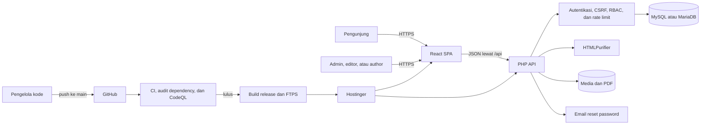
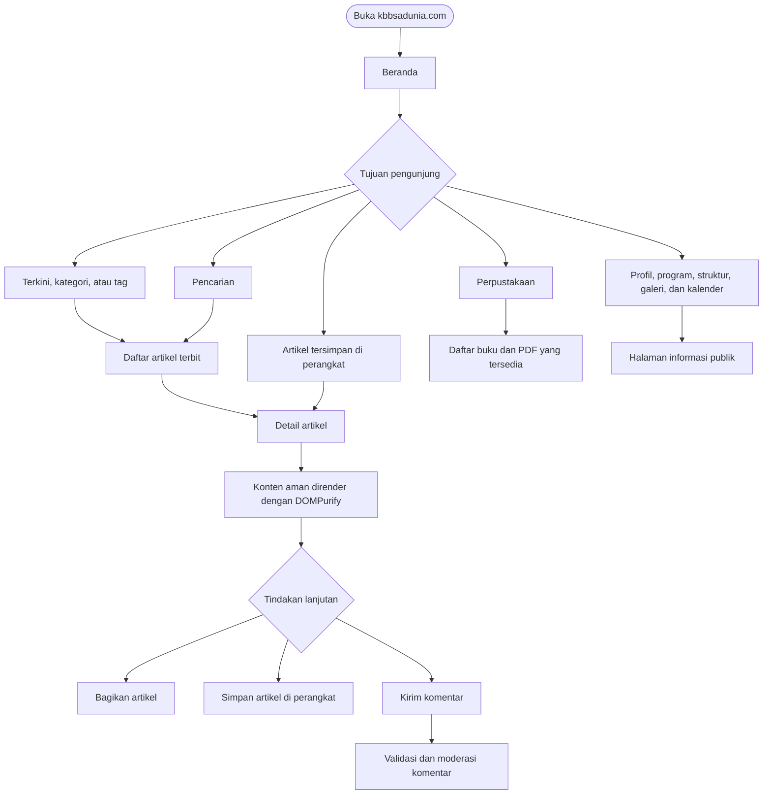
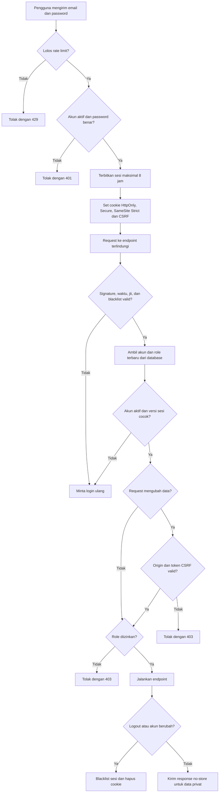
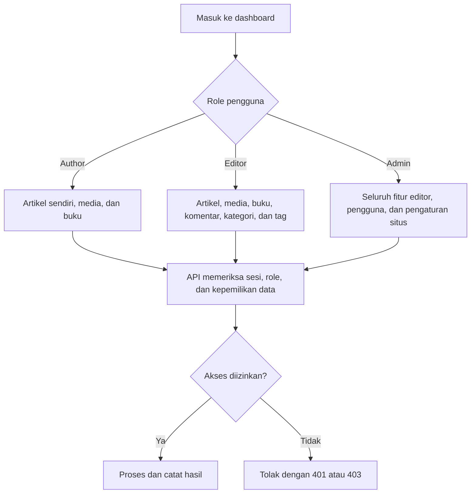
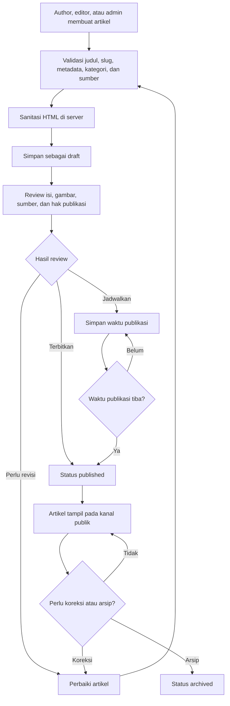
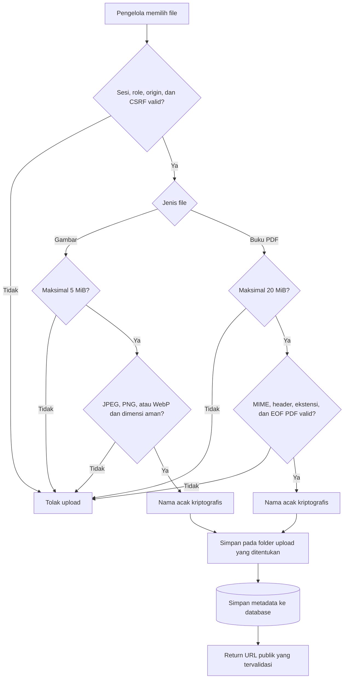
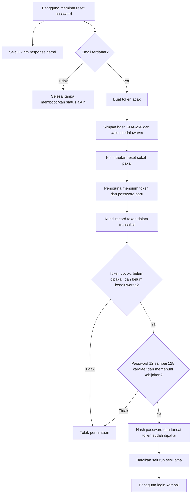
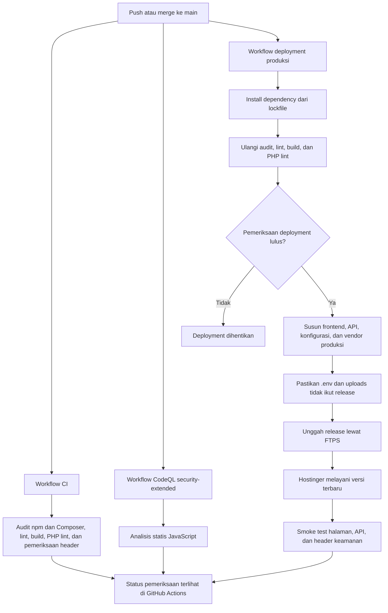

# Flowchart Portal KBB Sadunia

Dokumen ini adalah acuan alur aplikasi `kbbsadunia.com`. Diagram disusun dari route React, endpoint PHP, aturan role, validasi upload, dan workflow GitHub Actions yang benar-benar digunakan oleh aplikasi.

> Catatan keamanan: pembatasan menu di frontend hanya membantu pengalaman pengguna. Keputusan akses yang sebenarnya selalu dilakukan kembali oleh API berdasarkan sesi dan role terbaru di database.

## 1. Arsitektur sistem

## 2. Alur pengunjung

## 3. Login, sesi, dan otorisasi

## 4. Hak akses dashboard

Ringkasan route dashboard:

| Fitur | Author | Editor | Admin |
| --- | :---: | :---: | :---: |
| Dashboard, artikel, media, buku | Ya | Ya | Ya |
| Komentar, kategori, tag | Tidak | Ya | Ya |
| Pengguna dan pengaturan situs | Tidak | Tidak | Ya |

## 5. Siklus artikel

## 6. Upload gambar dan buku

## 7. Reset password

## 8. CI/CD ke Hostinger

## 9. Acuan saat mengubah aplikasi

Setiap perubahan route, endpoint, role, status artikel, aturan upload, atau proses deployment harus diikuti pembaruan dokumen ini. Urutan pemeriksaan sebelum perubahan masuk produksi adalah:

1. pastikan flowchart masih sama dengan implementasi;
2. jalankan lint, build, PHP lint, dan audit dependency;
3. cek bahwa API tetap menjadi sumber keputusan otorisasi;
4. push ke `main` dan tunggu seluruh GitHub Actions selesai;
5. lakukan smoke test pada `https://kbbsadunia.com` tanpa mengubah data produksi.
